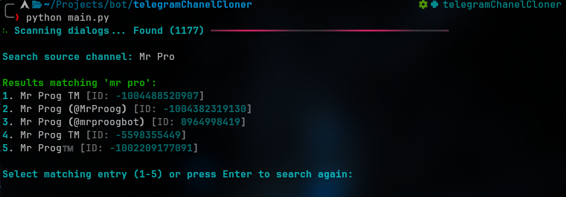

<p align="center">
  
</p>

# 🚀 Telegram Channel Cloner `v0.1.0`

[](https://www.python.org/)
[](https://github.com/LonamiWebs/Telethon)
[](LICENSE)
[](tests/)
[](#)

A high-performance, resilient asynchronous Telegram cloner engineered to migrate channel history, group archives, and Saved Messages with zero socket freezes, automated error recovery, and rate-limit shields.

---

## 🌟 What's New in v0.1.0

This release introduces major stability enhancements and addresses community feature requests:

- 🔁 **Failed Messages Auto-Retry Engine ([#1](https://github.com/MR-PR0G/Telegram-channel-cloner/issues/1))**: Retry only failed messages logged in `failed_messages.json` with `--retry-failed` without duplicating previously copied messages or resetting progress.
- ✂️ **Smart Caption Truncation & Chaining**: Eliminates `Caption too long` exceptions by automatically adhering to Telegram's 1024-character caption limit for media. Any overflow text is seamlessly dispatched as a chained reply.
- ☕ **Batch Cooldown Shield**: Added batch resting periods (`--batch-size` and `--batch-cooldown`) to protect accounts from sliding-window `FLOOD_WAIT` penalties during massive migrations (10,000+ messages).
- ⚡ **Instant Remote Sizing**: Resolves total channel message count in a single round-trip API call instead of scanning the full history.
- 🌐 **Expanded Proxy Support**: Native compatibility with **HTTP**, **SOCKS5**, and **SOCKS4** proxies.
- 🧪 **Automated Test Suite**: Integrated `pytest` test suite covering progress tracking, text transformations, caption safety, and message pipelines.

---

<p align="center">
  
</p>

---

## ✨ Core Features

- 🔄 **Strict Chronological Replication**: Clones from oldest to newest, preserving conversational flow and historical context.
- 🛡️ **Zero-Freezing Socket Recovery**: Automatically re-establishes connections on IP changes or network hiccups without hanging.
- 💬 **Saved Messages Integration**: Move posts directly to or from your personal "Saved Messages" using simple keywords.
- 📂 **Full Media & Album Support**: Handles single media, documents, voice notes, stickers, round video notes, and grouped albums across pagination boundaries without splitting.
- 🔍 **Single-Pass Dialog Search**: Fast cached search across accessible chats and channels.
- ✏️ **Automated Content Cleaning**: Auto-replace source channel handles (`@old` → `@new`), strip promotional patterns, or inject custom headers/footers.
- 🎛️ **Granular Filtering**: Filter by allowed media types, maximum file size in MB, date range, or message ID limits.
- 📌 **Pins & Topics**: Replicates pinned messages and supports Supergroup Forum Topics (Threads).
- 📊 **Real-Time Terminal Dashboard**: Clean, live Rich UI displaying speed (msg/s), completion percentage, elapsed time, and dynamic ETA.

---

## 🚀 Quick Start

### 1. Prerequisites
- **Python 3.12+**
- Telegram credentials (`API_ID` & `API_HASH`) from [my.telegram.org](https://my.telegram.org)

### 2. Setup
```bash
# Clone the repository
git clone https://github.com/MR-PR0G/Telegram-channel-cloner.git
cd Telegram-channel-cloner

# Create and activate virtual environment
python3 -m venv .venv
source .venv/bin/activate  # On Windows: .venv\Scripts\activate

# Install dependencies
pip install -r requirements.txt
```

### 3. Run
```bash
python main.py
```

---

## 🕹️ CLI Usage & Flags

| Flag | Parameter | Description |
|---|---|---|
| `--retry-failed` | None | Process failed items from `failed_messages.json` directly |
| `--resume` | None | Automatically resume previous session without prompting |
| `--no-resume` | None | Discard saved state and start a fresh cloning task |
| `--batch-size` | `int` | Number of messages copied before taking a rest |
| `--batch-cooldown` | `float` | Rest duration (in seconds) between batches |
| `--min-id` | `int` | Lowest message ID boundary |
| `--max-id` | `int` | Highest message ID boundary |

### Common Workflows

- **Retry Failed Messages Only**:
  ```bash
  python main.py --retry-failed
  ```

- **Clone Large Channels with Cooldown (e.g., 60s rest every 100 messages)**:
  ```bash
  python main.py --batch-size 100 --batch-cooldown 60
  ```

- **Unattended Resume**:
  ```bash
  python main.py --resume
  ```

---

## ⚙️ Configuration (`config.py` & `.env`)

You can configure settings via environment variables (in a `.env` file) or directly inside `config.py`:

```python
# API Credentials
API_ID = 0
API_HASH = ""

# Proxy Configuration
USE_PROXY = False
PROXY_TYPE = "HTTP"       # HTTP, SOCKS5, or SOCKS4
PROXY_HOST = "127.0.0.1"
PROXY_PORT = 2080

# Anti-Flood & Delays
ENABLE_RANDOM_DELAY = True
MIN_DELAY = 0.3
MAX_DELAY = 1.0

# Batch Rate-Limiting
BATCH_SIZE = 100
BATCH_COOLDOWN_SECONDS = 0.0   # Set > 0 (e.g. 60.0) to pause between batches

# Caption Safety
MAX_CAPTION_LENGTH = 1024
SPLIT_LONG_CAPTION = True      # Send overflow caption as reply
```

---

## 🧪 Automated Testing

Run the full test suite with:

```bash
pip install -r requirements-dev.txt
pytest -v tests/
```

All 12 unit and integration tests validate progress persistence, text processors, caption boundary splits, and message routing.

---

## 📄 License

Distributed under the MIT License. See [LICENSE](LICENSE) for more information.
