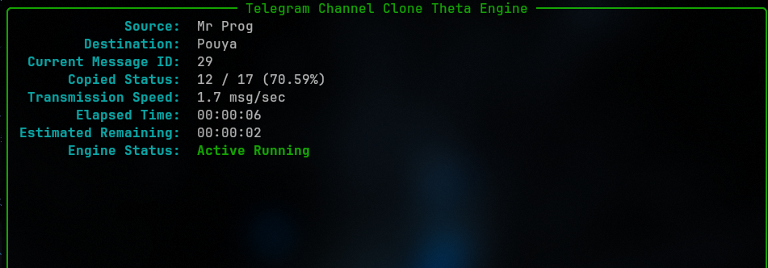

# 🚀 Telegram Channel Clone Theta (v0.1.2)

An ultra-resilient, production-grade asynchronous CLI application built with **Python 3.12+** and **Telethon** to seamlessly clone message histories from any accessible Telegram channel, group, or **Saved Messages** to a destination channel/group.

<p align="center">
  
</p>

<p align="center">
  
</p>

## ⚡ Quick Overview

Cloning massive Telegram channels (10,000+ to 50,000+ messages) often fails due to proxy disconnects, IP changes, rate limits, and frozen sockets. **Telegram Channel Clone Theta** is engineered from the ground up to handle unstable networks with **zero freezing**, **smart chunked pagination**, **auto-reconnection**, **resumable progress tracking**, and an **auto-retry engine for failed messages**.

---

## 🌟 What's New in v0.1.2

- 🛡️ **Protected Content Bypass (`ChatForwardsRestrictedError`)**: Channels with "Restrict saving content" enabled no longer fail. The engine automatically downloads the media to temporary storage, re-uploads it cleanly to the destination, and purges local temp files immediately.
- 🔗 **Smart Link Preview Handling (`MessageMediaWebPage`)**: Webpage previews and shared URLs are no longer misidentified as unknown media. All links, articles, and preview metadata are preserved and transmitted cleanly.
- 🎯 **Direct Input Resolution**: Paste channel IDs (`-100...`), `@username`, or `t.me/...` invite links directly into the interactive prompt without needing them to appear in cached dialogs.
- 📊 **Polls & Interactive Media**: Native cloning support for Telegram polls (`MessageMediaPoll`) and dice animations (`MessageMediaDice`).
- 🔁 **Failed Messages Auto-Retry Engine ([#1](https://github.com/MR-PR0G/Telegram-channel-cloner/issues/1))**: Dedicated `--retry-failed` mode to re-attempt failed messages logged in `failed_messages.json` without re-cloning already copied messages or resetting checkpoints.
- ✂️ **Smart Caption Truncation & Chaining**: Automatically conforms to Telegram's 1024-character caption limits on media. Excess text is sent as a chained reply to ensure no content is lost while preventing `Caption too long` exceptions.
- ☕ **Batch Pause & Rate-Limit Shield**: Configurable batch resting periods (`--batch-size` and `--batch-cooldown`) to protect accounts from sliding-window `FLOOD_WAIT` penalties during massive channel migrations.
- ⚡ **Instant Remote Size Calculation**: Resolves total channel message count in a single API call instead of scanning the full history.
- 🌐 **Extended Multi-Proxy Support**: Native compatibility with **HTTP**, **SOCKS5**, and **SOCKS4** proxies.
- 🔐 **Environment Configuration**: Seamlessly loads credentials and proxy settings from `.env` or system environment variables.

---

## 🌟 Key Features

- 🔄 **100% Chronological Execution**: Copies messages strictly from oldest to newest, preserving historical sequence perfectly.
- 🛡️ **Zero-Freezing Resilience & Protected Content Bypass**: Socket recovery mechanism that auto-reconnects on IP changes or proxy drops, paired with an automated download-and-upload pipeline to clone forward-restricted channels with content protection enabled.
- 🌐 **Multi-Proxy Support**: Built-in HTTP, SOCKS5, and SOCKS4 proxy support powered by `python-socks`.
- 💬 **Saved Messages Integration**: Clone directly to or from your personal "Saved Messages" using simple keywords (`saved`).
- 🔍 **Single-Pass Fast Search**: Caches all accessible dialogs once with a live scanning progress bar for instant searching.
- ✏️ **Text Cleaning, Auto Replacement & Signatures**: Auto-replace channel handles, remove custom text/patterns, and inject custom headers or footers.
- 📂 **Full Media & Album Compatibility**: Handles Text, Photos, Videos, Media Groups (Albums), Voice, GIFs, Documents, Stickers, Locations, Contacts, and Round Videos without album fragmentation across chunk boundaries.
- 🎛️ **Advanced Filtering Options**: Restrict cloning by allowed media types, max file size limits (e.g., max 50MB), Date Ranges (`YYYY-MM-DD`), or Message ID boundaries.
- 📌 **Pinned Messages & Forum Topics**: Syncs pinned messages automatically and supports Telegram Supergroup Forum Topics (Threads).
- ⏳ **Human Delay Jitter**: Configurable random delay between messages for natural behavior under Telegram's rate limit policies.
- 📊 **Live Rich CLI Dashboard**: Real-time terminal UI displaying copy speed, estimated time remaining (ETA), message count, and status alerts.
- ⚙️ **FloodWait & Error Isolation**: Gracefully sleeps on Telegram rate limits and logs missing/failed items without crashing.
- 💾 **Resumable Progress**: Saves state after every successfully copied message and resumes anytime from where you left off.

---

## 💻 Installation & Setup Guide

### 📋 Prerequisites

Before installing, ensure your system meets the following requirements:
- **Python**: Version `3.12` or higher ([python.org](https://www.python.org/downloads/)).
- **Git**: Installed on your system ([git-scm.com](https://git-scm.com/)).
- **Telegram Account**: Access to your account to obtain API credentials.

---

### 🔑 Step 1: Obtain Telegram API Credentials

To allow Telethon to connect securely to the Telegram network:
1. Log in to your account at [my.telegram.org](https://my.telegram.org).
2. Go to **API development tools**.
3. Create a new application (fill in a dummy App Title and Short Name).
4. Copy your unique **`api_id`** (an integer) and **`api_hash`** (a 32-character string).

---

### 🐧 Step 2A: Installation on Linux / macOS / Android
Open your terminal and execute the following commands step-by-step:
##### Android users can run the application directly on their phones using **Termux** (recommended to install from [F-Droid](https://f-droid.org/en/packages/com.termux/)):
#### 1. Clone the Repository
```bash
git clone https://github.com/MR-PR0G/Telegram-channel-cloner.git
cd Telegram-channel-cloner
```
#### 2. Create & Activate Virtual Environment
```bash
# Create virtual environment
python3 -m venv .venv

# Activate virtual environment
source .venv/bin/activate
```
#### 3. Install Required Dependencies
```bash
pip install -r requirements.txt
```

---

### 🪟 Step 2B: Installation on Windows

Open Command Prompt (cmd) or PowerShell and execute:
#### 1. Clone the Repository
```dos
git clone https://github.com/MR-PR0G/Telegram-channel-cloner.git
cd Telegram-channel-cloner
```
#### 2. Create & Activate Virtual Environment
```dos
# Create virtual environment
python -m venv .venv

# Activate in Command Prompt (CMD)
.venv\Scripts\activate

# OR Activate in PowerShell
.\.venv\Scripts\Activate.ps1
```
#### 3. Install Required Dependencies
```dos
pip install -r requirements.txt
```

---

## 🚀 Usage & CLI Options

### 1. Interactive Mode
Simply run the script:
```bash
python main.py
```
Theta will connect to Telegram, cache your dialogs with an animated progress bar, and prompt you to search for your source and destination channels.

### 2. Command-Line Arguments

| Flag | Parameter | Description |
|---|---|---|
| `--retry-failed` | None | Re-attempt copying all messages logged in `failed_messages.json` |
| `--resume` | None | Auto-resume previous cloning session without prompt |
| `--no-resume` | None | Start fresh cloning session, discarding previous progress |
| `--batch-size` | `int` | Number of messages copied before taking a rest |
| `--batch-cooldown` | `float` | Rest duration (in seconds) between batches |
| `--min-id` | `int` | Lowest message ID boundary to process |
| `--max-id` | `int` | Highest message ID boundary to process |

#### CLI Examples
- **Retry Failed Messages Only**:
  ```bash
  python main.py --retry-failed
  ```

- **Clone Large Channels with Cooldown (e.g. 60s rest every 100 messages)**:
  ```bash
  python main.py --batch-size 100 --batch-cooldown 60
  ```

- **Unattended Resume**:
  ```bash
  python main.py --resume
  ```

---

## 🛠️ Feature Tuning: How to Use `config.py` Effectively

The `config.py` file is packed with robust features. Below is a tactical guide on configuring them:

### 🛡️ 1. Maximizing Account Safety (Anti-Ban Measures)
Telegram monitors high-speed automated accounts. To make your cloning bot look completely human:
* **Enable Jitter:** Set `ENABLE_RANDOM_DELAY = True`.
* **Tune Intervals:** Keep `MIN_DELAY = 0.3` and `MAX_DELAY = 1.0`. This introduces a chaotic, human-like delay pattern between posts, safely shielding your account from harsh `FloodWait` penalties.

### ☕ 2. Batch Rate-Limiting & Cooldown (For Huge Channels)
When migrating 10,000+ messages, standard delays may not prevent Telegram's hourly sliding-window limits:
* **Configure Batch Size:** Set `BATCH_SIZE = 100` (every 100 messages).
* **Configure Cooldown:** Set `BATCH_COOLDOWN_SECONDS = 60.0` (rest for 60 seconds between batches).

### ✂️ 3. Smart Caption Safety & Chaining
* **Limit Enforcement:** Telegram limits media captions to 1024 characters.
* **Auto-Split:** `SPLIT_LONG_CAPTION = True` ensures that if a caption exceeds 1024 characters, the media is sent with the first 1024 characters, and the overflow is immediately dispatched as a chained reply.

### ✏️ 4. Content Cleaning & Automated Re-Branding
If you are cloning a public channel to your own private/public channel, clean up advertising links and signatures:
* **Auto Handle Swap:** Set `AUTO_REPLACE_USERNAMES = True`. Scans messages for username handles matching the source channel (e.g., `@old_channel`) and overwrites them with your new destination handle (e.g., `@new_channel`).
* **Custom Signatures:** Use `CUSTOM_HEADER` and `CUSTOM_FOOTER` to enforce global branding:
  ```python
  CUSTOM_FOOTER = "\n\n🌐 **Join our main hub:** @my_awesome_destination"
  ```
* **Advanced Stripping:** Populate `REMOVE_PATTERNS` with exact text blocks or Regex expressions to delete promotional tags or link shorteners automatically.

### 📂 5. Bandwidth Optimization & Media Filtering
Don't want to waste gigabytes of data on heavy movies, archives, or specific formats? 
* **Size Cap:** Set `MAX_FILE_SIZE_MB = 50.0`. Any video, document, or audio file exceeding 50 megabytes will be skipped.
* **Target Specific Formats:** Modify the `ALLOWED_MEDIA_TYPES` list. If you only care about text and pictures:
  ```python
  ALLOWED_MEDIA_TYPES = ["text", "photo"]
  ```

### 📅 6. Historical Scoping (Date & ID Ranges)
Instead of copying a channel's entire history, narrow down the operation window:
* **Date Bounds:** Set `START_DATE = "2026-01-01"` and `END_DATE = "2026-07-01"` to isolate and extract logs only from that specific timeframe.
* **ID Isolation:** Set `MIN_MSG_ID` and `MAX_MSG_ID` to replicate a specific range of message IDs.

### 💬 7. Supergroup Forums & Thread Syncing
Modern Telegram communities use structured Forum Topics. Theta fully supports cloning directly inside specific threads:
* Map target threads by passing their unique topic IDs into `SOURCE_TOPIC_ID` and `DESTINATION_TOPIC_ID`. (Leave them as `None` for standard linear channels).

---

## 💾 Session Reliability & Auto-Resume

Network drops, proxy time-outs, and unexpected machine reboots are inevitable during huge migrations. Theta handles this gracefully:
* Every single successfully cloned message updates a state file called `progress.json`.
* If the app is terminated, simply rerun `python main.py`. 
* The system will detect the active checkpoint, read your source/destination logs, and give you an interactive prompt to **Resume from exactly where you left off**, guaranteeing zero double-posts or lost messages.

---

## ❓ Troubleshooting & FAQ

<details>
<summary><b>1. <code>FloodWaitError: A wait of X seconds is required</code></b></summary>

- **Cause:** Telegram strictly enforces API request rate limits.
- **Solution:** Theta automatically detects `FloodWaitError`, pauses execution safely for `X` seconds, and resumes without losing progress. To reduce the likelihood of encountering FloodWait:
  - Set `ENABLE_RANDOM_DELAY = True` in `config.py`.
  - Increase `MIN_DELAY` and `MAX_DELAY` values (e.g., `0.5` and `1.5`).
  - Enable Batch Cooldown (`--batch-size 100 --batch-cooldown 60`).
</details>

<details>
<summary><b>2. <code>sqlite3.OperationalError: database is locked</code></b></summary>

- **Cause:** Another instance of `main.py` or a Telethon process is actively using the `.session` file in the `session/` folder.
- **Solution:** Close all other terminal sessions or background python processes using the session file, then re-launch `python main.py`.
</details>

<details>
<summary><b>3. <code>ChannelPrivateError</code> / <code>ChatAdminRequiredError</code></b></summary>

- **Cause:** You are trying to clone from a private channel you haven't joined, or trying to send posts to a destination channel where your account lacks admin publishing privileges.
- **Solution:**
  - Ensure your Telegram account is an active member/subscriber of the source channel.
  - Make sure your account has **"Post Messages"** admin permission in the destination channel.
</details>

<details>
<summary><b>4. Proxy Connection Errors (e.g., <code>python_socks.GeneralProxyError</code>)</b></summary>

- **Cause:** Invalid proxy IP, port, or proxy server downtime.
- **Solution:**
  - Verify your proxy server is running locally or remotely (e.g., test IP/port `127.0.0.1:2080`).
  - Check `PROXY_TYPE` in `config.py` (`HTTP`, `SOCKS5`, or `SOCKS4`).
  - If you are not using a proxy, ensure `USE_PROXY = False` in `config.py`.
</details>

<details>
<summary><b>5. <code>SessionPasswordNeededError</code></b></summary>

- **Cause:** Two-Factor Authentication (2FA) is enabled on your Telegram account.
- **Solution:** When prompted by the CLI, enter your 2FA Cloud Password. Password inputs are masked automatically for privacy.
</details>

<details>
<summary><b>6. <code>ModuleNotFoundError: No module named 'rich'</code> (or 'telethon')</b></summary>

- **Cause:** The virtual environment is either not activated or missing required dependencies.
- **Solution:** Activate your virtual environment and run the dependency installer:
  ```bash
  source .venv/bin/activate  # On Linux/macOS
  .\.venv\Scripts\activate   # On Windows
  pip install -r requirements.txt
  ```
</details>

<details>
<summary><b>7. How do I find Topic IDs for Telegram Supergroup Forums?</b></summary>

- **Solution:**
  1. Open Telegram Desktop and navigate to your Supergroup Forum.
  2. Right-click on any post inside the specific topic and select **Copy Post Link**.
  3. The link format is `https://t.me/c/123456789/TOPIC_ID/MSG_ID`.
  4. Extract the middle integer (`TOPIC_ID`) and paste it into `SOURCE_TOPIC_ID` or `DESTINATION_TOPIC_ID` in `config.py`.
</details>

---

## 🏗️ Project Architecture & Developer Guide

### 📂 Directory Structure
```
telegram-channel-cloner/
├── config.py           # Configuration parameters & environment loader
├── main.py             # CLI entry point, argument parsing & workflow coordinator
├── requirements.txt    # Production dependencies
├── requirements-dev.txt# Development & testing dependencies
├── LICENSE             # MIT License
├── README.md           # Comprehensive documentation
├── tests/              # Test suite (message handling, progress, text processing)
└── src/
    ├── __init__.py          # Package initializer
    ├── authentication.py    # Telethon client session, proxy & 2FA authentication
    ├── cloner.py            # Async cloning engine, retry processor & Rich UI table
    ├── dialog_search.py     # Dialog caching, filtering & interactive CLI search
    ├── logger.py            # Rotating file logging setup
    ├── media.py             # Media classification and album (grouped_id) helpers
    ├── message_handler.py   # Message routing, text cleaning & metadata mapping
    ├── progress.py          # State tracking, failed message queue & crash recovery
    ├── sender.py            # Safe transmission wrappers (caption truncation, FloodWait handling)
    └── utils.py             # Text replacement, date filters, and delay jitter
```

---

## 🧪 Testing

To run the test suite:
```bash
pip install -r requirements-dev.txt
pytest
```

---

## 🤝 Contributing & Support

Contributions, bug reports, and feature requests are welcome!

- Give a ⭐️ **Star** if this project helped you!
- Feel free to open an **Issue** or submit a **Pull Request**.

### Designed with ❤️ by [MR-PR0G](https://github.com/MR-PR0G)

---

## 📄 License

This project is licensed under the MIT License. See [LICENSE](LICENSE) file for details.
